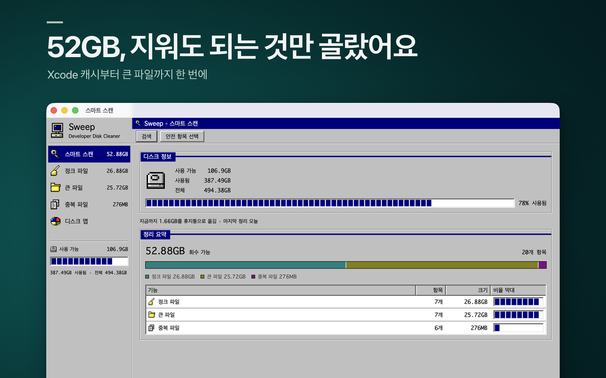
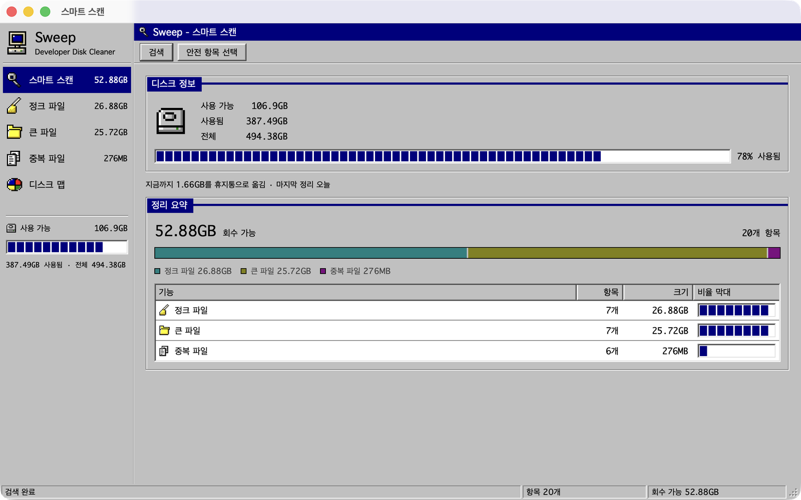
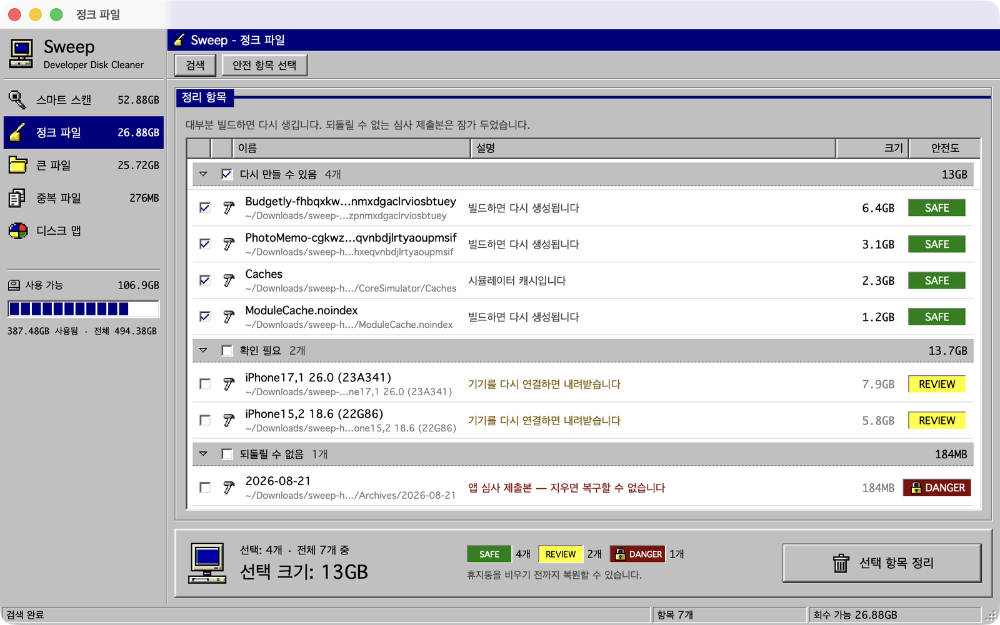
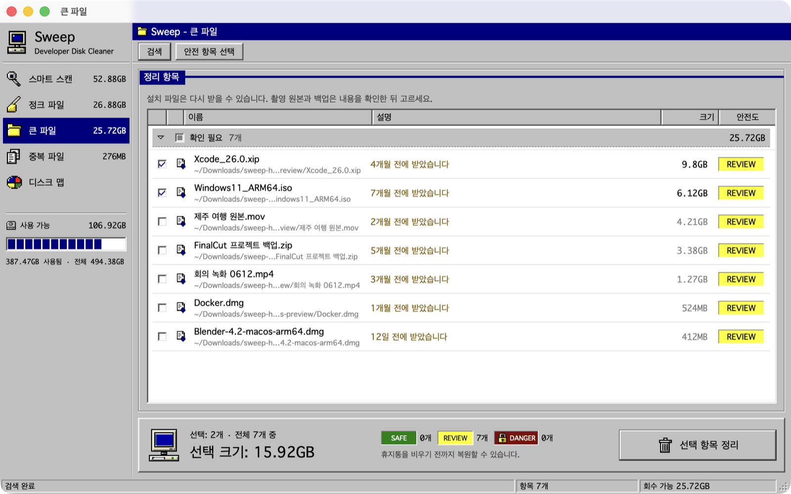
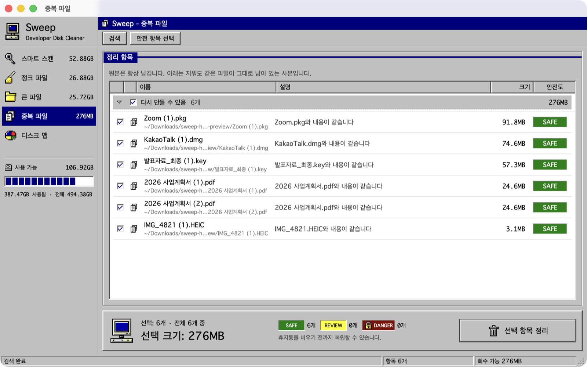
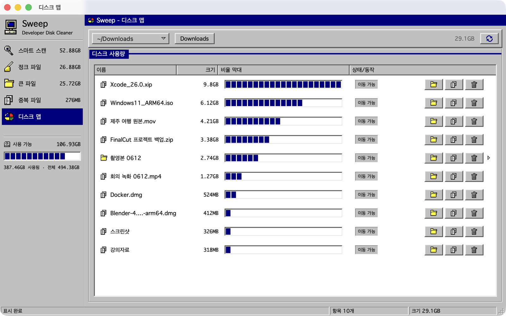
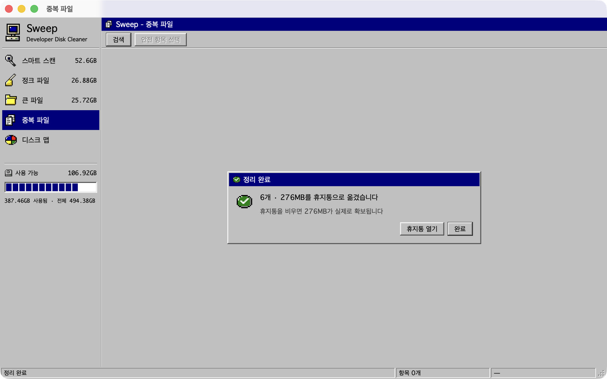

# Sweep

macOS 개발 머신의 디스크를 정리하는 앱.

Xcode 산출물, 개발 도구·앱 캐시, **폭주 중인 임시 파일**, 잊고 있던 큰 파일과 중복 내려받기를 찾아
안전도별로 보여주고 휴지통으로 보낸다. 방금 정리한 것은 되돌릴 수 있다.



**1.0.2** · macOS 14+ · 한국어 / English · 인터넷 연결 없음, 데이터 수집 없음

## 화면

| 스마트 스캔 | 정크 파일 |
|---|---|
|  |  |
| 한 번 훑어 기능별로 회수할 수 있는 용량을 요약한다 | 항목마다 왜 지워도 되는지 적고, 안전도별로 묶는다 |

| 큰 파일 | 중복 파일 |
|---|---|
|  |  |
| `~/Downloads`의 100MB 이상 파일을 크기순으로 | 내용이 같은 파일만 묶고, 가장 먼저 받은 원본은 남긴다 |

| 디스크 맵 | 정리 완료 |
|---|---|
|  |  |
| 폴더를 눌러 들어가며 무엇이 공간을 차지하는지 본다 | 휴지통을 비워야 공간이 생긴다는 것까지 알려준다 |

## 기능

| 탭 | 하는 일 |
|---|---|
| 스마트 스캔 | 아래 세 탭을 한 번에 훑고 결과를 탭마다 나눠 담는다. 디스크 사용량과 지금까지 정리한 누적 용량도 보여준다 |
| 정크 파일 | 다시 만들어지는 것들. 아래 다섯 갈래 |
| 큰 파일 | `~/Downloads`의 독립 파일 중 100MB 이상. 받은 지 며칠 됐는지 함께 |
| 중복 파일 | `~/Downloads`에서 내용까지 같은 파일 |
| 디스크 맵 | 폴더 크기를 막대로 비교. 그 자리에서 Finder로 열기·경로 복사·휴지통 |
| CPU | 지금 CPU를 쓰는 프로세스를 점유율 순으로. 보기만 하고 끝내지는 않는다 |

정크 파일의 갈래:

| 갈래 | 대상 |
|---|---|
| 폭주 임시 파일 | `/private/var/folders`·`/private/tmp`에서 지금 커지고 있는 것 |
| Xcode · 시뮬레이터 | DerivedData, iOS DeviceSupport, 시뮬레이터 캐시, Archives |
| 개발 캐시 | `~/Library/Caches`의 개발 도구 캐시, `~/Library/Logs`, `~/.npm`·`~/.expo` 안의 캐시 폴더 |
| 앱 웹 캐시 | Slack·Notion 같은 Electron·Chromium 앱의 `Cache`·`GPUCache` 등 |
| 묵은 캐시 | 90일 넘게 손대지 않은 `~/Library/Caches` 항목 |

그 밖에:

- **되돌리기** — 정리 완료 화면에서 방금 정리한 회차를 원래 자리로 돌려놓는다
- **휴지통 안내** — 휴지통으로 옮겼을 뿐 아직 공간이 생기지 않았다는 것을 알리고 휴지통을 연다
- **메뉴 막대** — 디스크 사용량과 회수 가능 용량을 보고, 창을 열지 않고 검색을 시작한다
- **단축키** — ⌘R 검색, ⌘⌫ 정리

## 설계

### 화이트리스트 관문

`ProtectedPaths`가 모든 삭제의 관문이다. 블랙리스트가 아니라 **화이트리스트**라,
아래 루트의 *하위*가 아니면 전부 거부한다.

```
~/Library/Developer   ~/Library/Caches   ~/Library/Logs   ~/Downloads
~/.npm                ~/.expo            /private/var/folders   /private/tmp
```

`~/Library/Application Support`는 루트에 **없다.** 그 아래는 기본이 사용자 데이터라
통째로 열면 관문이 무너진다. 대신 끝 이름이 맞는 캐시 폴더만 연다 —
`Cache`·`Code Cache`·`GPUCache`·`Dawn*Cache`·`Service Worker/CacheStorage`.
`IndexedDB`·`Local Storage`·앱의 로컬 DB는 이름이 다르므로 계속 거부된다.

허용 루트 안이어도 프로비저닝 프로파일·키바인딩·테마는 deny-list로 막는다.
경로 비교는 문자열 접두사가 아니라 구성요소 단위라 `~/Downloads-backup`을
`~/Downloads`의 하위로 오판하지 않는다. 심볼릭 링크가 허용 범위 밖을 가리키면
실경로를 풀어 거부한다.

그 밖에 루트 자체·홈·다른 사용자나 시스템 소유 파일·SIP 보호 경로도 거부한다.

관문은 **두 번** 통과한다. `ScanCoordinator`가 스캔 결과를 거르고,
`Remover`가 삭제 직전 다시 검증한다. 스캐너 버그가 삭제까지 이어지면 안 된다.

### 안전도

"다시 만들 수 있는가"로 나눈다. **safe만 기본 선택**되므로,
전체 선택 후 삭제를 눌러도 되돌릴 수 없는 것은 빠져 있다.

| | 뜻 | 예 |
|---|---|---|
| `safe` | 재생성된다 | DerivedData, 각종 캐시 |
| `caution` | 다시 받을 수 있지만 시간이 든다 | iOS DeviceSupport |
| `danger` | 대체물이 없다 | Archives (앱 심사 제출본) |

### 폭주 임시 파일 탐지

"큰 파일"이 아니라 **"커지고 있는 파일"**을 찾는다.
크기를 두 번 재서 증가분을 분당 속도로 환산한다 (`33.0 MB/분 증가 중`).
증가 중이면 무언가 쓰고 있다는 뜻이라 `caution`으로 둔다.

### CPU 탭은 보기만 한다

끝내는 버튼이 없다. **App Store 빌드에서는 남의 프로세스를 죽일 수 없기 때문이다.**
서명한 번들로 세 갈래를 모두 재 봤다:

| 시도 | 샌드박스 |
|---|---|
| `kill(pid, SIGTERM)` | `EPERM` — `(allow signal (target same-sandbox))`만 열려 있다 |
| `NSRunningApplication.terminate()` / `forceTerminate()` | 둘 다 `false` |
| Automation entitlement + Apple Event `quit` | `-600 "Application isn't running"` — 떠 있는데도 |

프로세스 사용률은 **활성 상태 보기·`top`과 같이 코어 하나를 100%**로 센다. 스레드를
넷 쓰는 프로세스는 396%로 나오고(실측), 8코어면 전부 합쳐 최대 800%다. 한때 코어 수로
나눠 기계 전체를 100으로 봤는데, 활성 상태 보기와 8배씩 달라 화면을 보자마자 "왜
다르냐"가 나왔다.

**사용자·시스템·유휴는 프로세스 합이 아니라 커널 합계**(`host_statistics`의
`HOST_CPU_LOAD_INFO`)에서 읽는다. 목록은 내 계정 프로세스만 읽히므로, 그 합으로
유휴를 셈하면 root 소유인 WindowServer·kernel_task 몫이 유휴로 둔갑한다 —
실측 load avg 112에서 유휴 32.5%로 나왔다. 둘의 차이는 프로세스 목록에
"kernel_task·WindowServer 등 목록 밖 합계" 행으로 끼워 넣는다 — 샌드박스는 root·시스템
계정 프로세스를 하나씩 읽지 못한다(`proc_pidinfo`·`proc_pid_rusage` EPERM, setuid `top`
실행도 막힘, 실측). 이 줄엔 측정 사이에 떴다 끝난 짧은 프로세스 몫도 섞인다 — 빌드 중
기계 787% 가운데 `top`도 약 390%를 어느 행에도 붙이지 못했다.

분모는 약속한 측정 구간이 아니라 **실제로 흐른 시간**이다. `Task.sleep`은 최소
시간만 보장해서, 기계가 바쁘면 더 자고 그 초과분이 사용률로 둔갑한다 — 하필
이 화면을 볼 이유가 있는 순간에 틀린다.

읽는 쪽은 열려 있지만 **`proc_listpids`는 막힌다**(실측 0개). 목록은
`sysctl KERN_PROC_ALL`로 얻는다. 누적 CPU 시간은 `proc_pidinfo`로 읽는데,
그 값은 나노초가 아니라 **Mach 절대시간**이라 환산해야 한다 — 빼먹으면
코어를 꽉 채운 프로세스가 2.4%로 찍힌다.

`proc_pid_rusage`는 처음부터 나노초를 주지만 쓸 수 없다. 샌드박스가
`process-info-rusage`를 자기 자신에게만 열어 둔다.

내 계정 소유만 읽힌다(실측 521개 중 322개). `ps`·`top`이 root 프로세스까지
보여 주는 것은 그 둘이 setuid root이기 때문이다.

### 중복 탐지

크기 → 앞 64KB SHA256 → 전체 SHA256 3단계.
크기가 다르면 내용이 같을 수 없으므로 1단계에서 해시 비용을 크게 아낀다.
같은 내용 N개 중 가장 먼저 받은 1개는 원본으로 남긴다.

읽지 못한 파일(권한 없음·iCloud 미다운로드·읽기 오류)은 **어느 묶음에도 넣지 않는다.**
읽을 수 없는 두 파일을 "내용이 같다"고 할 근거는 없다 — 빈 해시로 묶이면
서로 다른 파일이 `safe` 중복이 되어 한쪽이 휴지통으로 간다.

### 되돌리기

`Remover`는 휴지통으로 옮긴 항목의 **새 위치**를 결과에 담는다. `Restorer`가 그것을 원래 자리로
돌려놓는데, 되돌리기도 파일을 쓰는 동작이라 지울 때와 같은 관문을 다시 지난다 — 그 사이 부모 폴더가
허용 범위 밖을 가리키는 링크로 바뀌었다면 쓰지 않는다. 되돌린 회차는 `CleanupHistory`의 누적 용량에서
뺀다. 기록에는 경로 없이 숫자만 남긴다.

### App Store 샌드박스

샌드박스에서는 사용자가 열기 대화상자에서 고른 폴더만 읽을 수 있다. 그래서 두 축을 나눴다.

- 허락 = "읽을 수 있는가" (`FolderAccess`, 보안 범위 북마크로 다음 실행에도 유지)
- 루트 = "지워도 되는가" (`ProtectedPaths`)

`~/Library`를 허락받아도 허용 루트는 넓어지지 않는다. 허락은 루트를 켜고 끄는 열쇠로만 쓴다.
`/private/tmp`처럼 고를 수 없는 경로는 App Store 판에서 빠진다. 자세한 내용은
[`docs/APPSTORE.md`](docs/APPSTORE.md).

## 실행

```bash
swift run SweepApp              # GUI
swift run SweepApp --scan-only  # 창 없이 스캔 결과만 출력 (아무것도 지우지 않음)
swift run SweepApp --cpu-only   # 창 없이 CPU 상위 프로세스만 출력
swift test                      # 603개 테스트
```

| 하려는 일 | 볼 곳 |
|---|---|
| 직접 배포 (Developer ID 서명·공증) | [`docs/RELEASE.md`](docs/RELEASE.md) |
| Mac App Store 제출 | [`docs/APPSTORE.md`](docs/APPSTORE.md) |
| 현지화 키 뽑기·카탈로그 맞추기 | `scripts/l10n.sh` |
| 스토어 스크린샷 합성 | `scripts/store-screenshots.swift` |

## 구조

```
SweepKit/
  Safety/       ProtectedPaths — 삭제 관문
                FolderAccess, Sandbox, FullDiskAccess — 읽기 권한
  Model/        CleanupItem, SafetyLevel, ScanCategory
  Scan/         CleanupScanner 프로토콜 + 스캐너 7종 + ScanCoordinator
  Remove/       Remover, Restorer, CleanupHistory, RemovalReport
  Insight/      DiskUsageTree, DiskMapModel, VolumeUsage — 디스크 맵
                CPUModel, ProcessCPUSampler — CPU
  Presentation/ AppModel, ScanModel, Feature — SwiftUI 비의존 상태 관리
SweepApp/       SwiftUI 화면
  Retro95/      Win95 스타일 컴포넌트
```

`CleanupScanner`가 `Scanner`가 아닌 이유는 `Foundation.Scanner`와 충돌하기 때문이다.

## 요구사항

macOS 14+ / Swift 6
